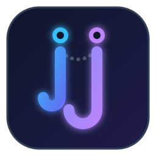

# Jujutsu (jj) for Visual Studio Code

A VS Code extension providing first-class integration with the [Jujutsu (jj)](https://github.com/martinvonz/jj) version control system.

  

## Features

- **Interactive Graph Webview**: Visualize your Jujutsu revision log, branch heads, working copy (`@`), and commit history directly in VS Code.
- **Source Control Integration**: Seamless SCM view showing working copy changes, parent diffs, and untracked modifications.
- **Unified Multi-Diff Inspection**: Review multi-file changes across revisions in VS Code's native diff editor.
- **Remote Manager**: Manage remotes, track remote branches, and trigger fetch/push operations.
- **Conflict Resolution**: Native commands to detect, inspect, and resolve 3-way conflicts in Jujutsu repositories.

## Requirements

- [Jujutsu CLI (`jj`)](https://github.com/martinvonz/jj#installation) must be installed and accessible in your system `PATH`.

## Extension Settings

This extension utilizes your standard Jujutsu configuration (`~/.jjconfig.toml` or repo `.jj/repo/config.toml`).

## License

MIT
